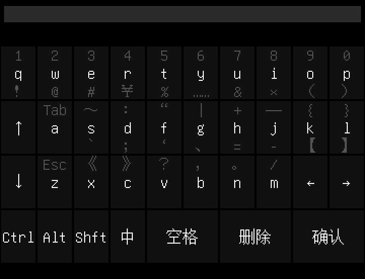
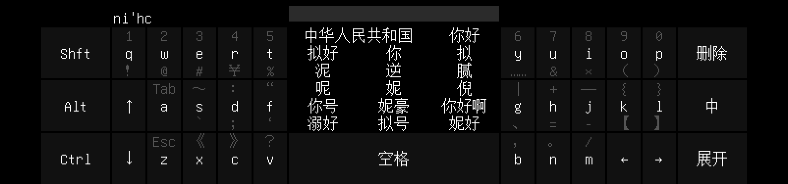
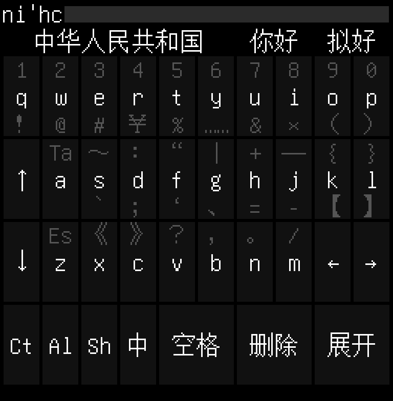
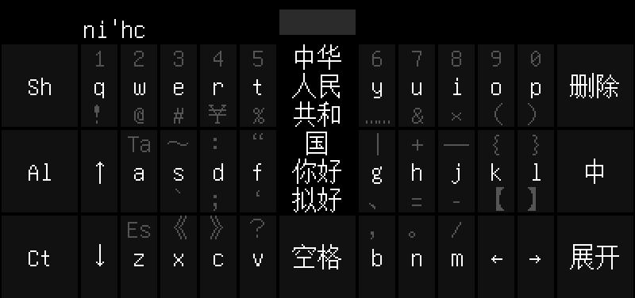
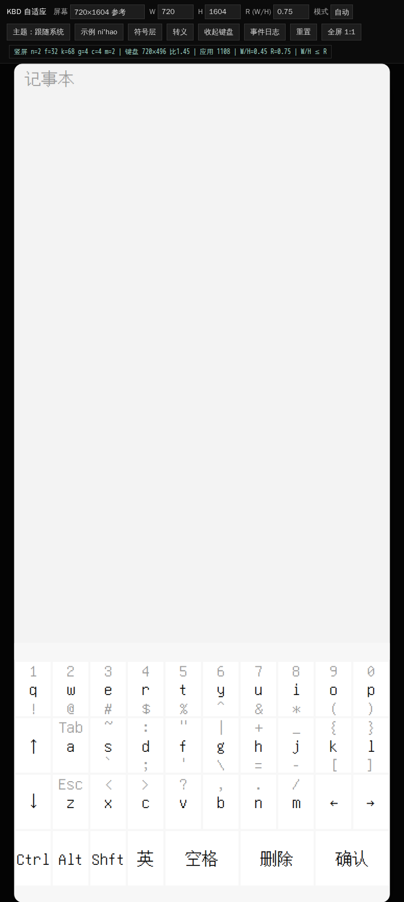

# KBD

当前版本：**1.1**

一个面向中文的 Android 输入法，目标设备为 Android。键盘几何按屏幕宽高自适应，竖屏/横屏共用一套 libime 拼音引擎。

## 特性

- **全拼 + 5 种 26 键双拼**：全拼、小鹤、自然码、智能ABC、中文之星、国标。默认全拼。
- **精确像素自适应**：按屏幕 `W/H` 选择竖/横模式，键宽、字号、缝隙、边距按整数像素推进；720×1604 与 1604×720 精确复现基准设计。
- **四色无边框视觉**：深/浅两套 4 色主题，`\sk` 切换。
- **转义命令**：`\zh` 切换方案，`\sk` 切换皮肤，`\st` 切换简繁，`\sb` 调整底部安全区。
- **输入增强**：A+B 用户自学习与上文预测（libime `HistoryBigram` + `PinyinContext`），跨输入框保留 10 字上文。
- **标准键盘能力**：Ctrl/Alt/Shift 组合键、Tab/Esc、符号层翻页、长按锁定/连发。

## 截图

| 竖屏 720×1604 | 横屏 1604×720 |
| --- | --- |
|  |  |

| 768×1024 自适应 | 800×800 自适应 |
| --- | --- |
|  |  |

## 原型

`webdemo/` 是可交互的屏幕自适应原型，用于在浏览器里调 `W/H`、`R`、主题和尺寸预设：



```sh
cd webdemo
python3 -m http.server 8765
# 打开 http://127.0.0.1:8765/
```

## 安装

从 GitHub Releases 下载 `app-release.apk`，在系统设置中启用 KBD 输入法并切换为当前输入法。

- 最低 Android 8.0（API 26），仅 `arm64-v8a`。
- 发布 APK 使用项目维护者的本地签名密钥；从源码自行构建的 APK 可以正常安装，但与官方 APK 不能互相覆盖升级。

## 使用

桌面打开 **KBD** 应用可查看完整帮助（当前方案、命令、手势）。长按空格进入转义：

| 命令 | 作用 |
| --- | --- |
| `\zh=quanpin` | 全拼 |
| `\zh=xiaohe` | 小鹤双拼 |
| `\zh=ziranma` / `\zh=abc` | 自然码 / 智能ABC |
| `\zh=zhongwenzhixing` / `\zh=gb` | 中文之星 / 国标 |
| `\sk=dark` / `\sk=light` / `\sk=auto` | 暗色 / 亮色 / 跟随系统 |
| `\st=s` / `\st=t` | 简体 / 繁体 |
| `\sb=32` / `\sb=auto` | 底部安全区固定 / 跟随系统 |
| `\n` / `\t` / `\u4f60` / `\\` | 换行 / 制表 / Unicode / 反斜杠 |

## 构建

第三方源码与词典数据不在仓库中，按 [docs/dev-env.md](docs/dev-env.md) 准备：

```sh
. scripts/env.sh
sh scripts/host-gen-data.sh
sh scripts/sync-assets.sh
cd android
gradle :app:assembleRelease
```

产物：`android/app/build/outputs/apk/release/app-release.apk`。

发布签名读取 `android/keystore.properties`（已 gitignore）。没有该文件时 release 构建回退到 debug 签名。

## 结构

| 目录 | 内容 |
| --- | --- |
| `android/app` | 五层前端（data/layout/view/input/app）+ Android 适配 |
| `android/engine` | libime JNI 封装、自学习/上文、宿主联调程序 |
| `webdemo` | 自适应几何原型（真值来源） |
| `docs` | 真值表、后端设计、自适应规则、开发环境 |
| `scripts` | 宿主端断言、预览渲染、数据生成、构建辅助 |

## 文档

- [屏幕自适应几何规则](docs/kbd-adaptive.md)
- [前端真值表](docs/kbd-parity.md)
- [后端设计](docs/kbd-backend.md)
- [开发环境](docs/dev-env.md)

## 许可证

GPL-3.0-or-later。第三方组件与字体许可见 [THIRD_PARTY_NOTICES.md](THIRD_PARTY_NOTICES.md)。

Copyright (C) 2026 one18mb and KBD contributors.
