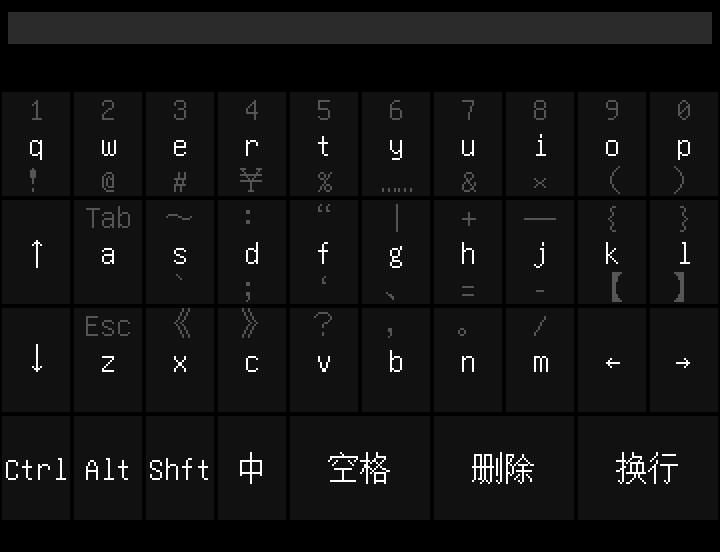
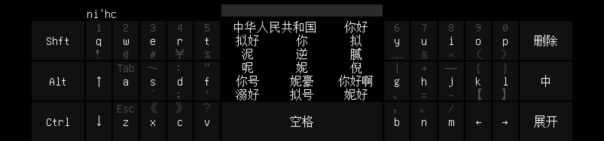
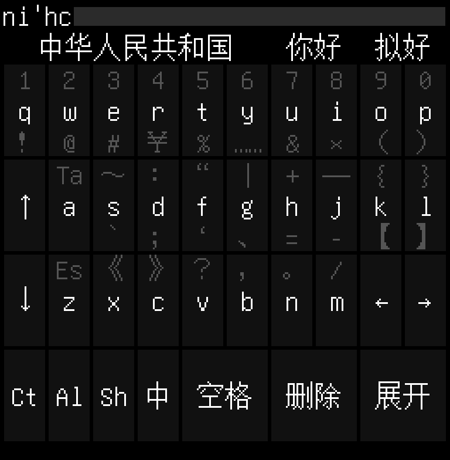
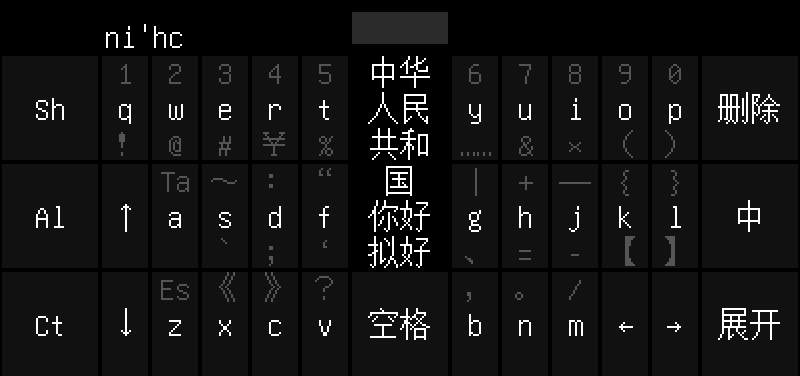

# KBD（键盘输入法）

最新发布：**1.3**。本 README 描述 `main` 分支。

键盘输入法（KBD）是面向极客的中文 Android（安卓）输入法：标准键盘 + 墨水屏友好的整数像素排版。离线运行，不申请网络权限。

## 截图

| 竖屏 | 横屏 |
| --- | --- |
|  |  |

| 3:4 自适应 | 方形屏 |
| --- | --- |
|  |  |

## 特性

- **标准键盘能力**：Ctrl/Alt/Shift、Tab/Esc、方向键和符号层都能组合；修饰键支持粘滞与锁定，适合终端、IDE、远程桌面。
- **墨水屏友好**：整数像素网格、Unifont 点阵字、四色高对比，不使用渐变、阴影或半透明；静态刷新设备上边界更清晰。
- **隐私安全**：不申请网络权限，不上传输入内容；词典、自学习词库和设置只保存在本机，卸载即清除。
- **全拼 + 5 种 26 键双拼**：全拼、小鹤、自然码、智能ABC、中文之星、国标。默认全拼。
- **整数像素自适应**：按窗口 `W/H` 选择竖/横模式，键宽、字号、缝隙、边距按整数像素推进。
- **自学习与上文联想**：常用词与上一句上下文参与候选，跨输入框保留 10 字上文。

## 适合谁

键盘输入法不是全能输入法：只提供 26 键布局，不支持九宫格和语音输入。

- **适合**：需要中文输入 + 标准键盘能力的极客；终端、IDE、远程桌面；墨水屏设备（阅读为主，偶尔输入）。
- **不适合**：只习惯九宫格、依赖语音输入，或需要花哨皮肤、动画和云输入的用户。

墨水屏用户通常以阅读为主，键盘输入法不是阅读器输入方案；但在需要输入时，它的布局比常见输入法更可控。

## 安装

从 GitHub Releases 下载 `KBD-<版本>-arm64-v8a.apk`（如 `KBD-1.3-arm64-v8a.apk`）。

- 最低 Android 8.0（API 26），仅 `arm64-v8a`。
- 发布 APK 使用项目维护者的本地签名密钥；从源码自行构建的 APK 可以安装，但与官方 APK 不能互相覆盖升级。

## 快速上手

1. 系统设置 → 语言与输入法 → 启用键盘输入法。
2. 将键盘输入法设为当前输入法，在输入框中调出键盘。
3. `中/英` 切换中英文；长按打开符号层。
4. `空格` 组词时选首选，否则输入空格；长按进入 `\` 转义。
5. `换行` 点按换行，长按收起键盘。
6. 桌面打开键盘输入法应用可查看完整手册。

## 命令

长按空格进入 `\`，输入命令后按空格执行：

| 命令 | 作用 |
| --- | --- |
| `\zh=quanpin` | 全拼（默认） |
| `\zh=xiaohe` / `\zh=ziranma` | 小鹤 / 自然码 |
| `\zh=abc` / `\zh=zhongwenzhixing` | 智能ABC / 中文之星 |
| `\zh=gb` | 国标双拼 |
| `\sk=dark` / `\sk=light` / `\sk=auto` | 暗色 / 亮色 / 跟随系统 |
| `\st=s` / `\st=t` | 简体 / 繁体 |
| `\sb=32` / `\sb=auto` | 底部安全区固定 / 跟随系统 |
| `\n` / `\t` / `\u4f60` / `\\` | 换行 / 制表 / Unicode / 反斜杠 |

## 官网

[https://one18mb.github.io/kbd/](https://one18mb.github.io/kbd/)

官网提供下载入口、可交互键盘示例、功能与双拼方案说明，以及文档和源码链接。示例区的布局与 Android 共用同一套算法，候选用 mock 数据，不运行 libime。开发调试面板可通过 `?dev=1` 打开。本地运行方式见 [docs/development.md](docs/development.md)。

## 文档

- [几何规则](docs/geometry.md)：布局开发者；模式、变量、进位、候选、短标签
- [行为规则](docs/behavior.md)：交互开发者；按键、手势、转义、候选、符号层
- [引擎](docs/engine.md)：引擎/JNI 开发者；libime、方案、自学习与上文、数据
- [开发与发布](docs/development.md)：维护者；环境、构建、测试、Pages、发布

## 构建

第三方源码与词典数据不在仓库中，按 [docs/development.md](docs/development.md) 准备：

```sh
. scripts/env.sh
sh scripts/host-gen-data.sh
sh scripts/sync-assets.sh
cd android
gradle :app:assembleRelease
```

产物：`android/app/build/outputs/apk/release/app-release.apk`。

发布签名读取 `android/keystore.properties`（已 gitignore）。没有该文件时 release 构建回退到 debug 签名。

## 结构

| 目录 | 内容 |
| --- | --- |
| `android/app` | 五层前端（data/layout/view/input/app）+ Android 适配 + 手册页 |
| `android/engine` | libime JNI 封装、自学习/上文、宿主联调程序 |
| `webdemo` | 官网与在线示例（视觉/交互 + mock 候选） |
| `docs` | 几何、行为、引擎、开发与发布 |
| `scripts` | 宿主端断言、预览渲染、数据生成、构建辅助 |

如果键盘输入法对你有用，欢迎 Star / Watch 关注版本更新。

## 许可证

GPL-3.0-or-later。第三方组件与字体许可见 [THIRD_PARTY_NOTICES.md](THIRD_PARTY_NOTICES.md)。

Copyright (C) 2026 one18mb and KBD contributors.
